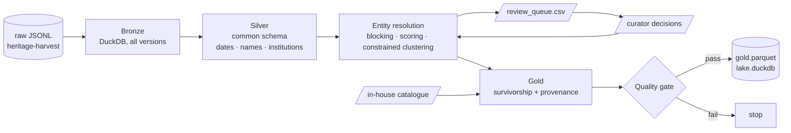

# heritage-lake

Turn messy, multi-source, multilingual cultural-heritage records into **one reliable dataset**: cleaned, de-duplicated, merged with in-house research data, quality-gated, and traceable field by field back to the source.

Stage 2 of a three-repo pipeline:

| Stage | Repo | What it does |
|---|---|---|
| 1. Harvest | [heritage-harvest](https://github.com/jaogye/heritage-harvest) | Scrape and collect raw records, with provenance |
| **2. Integrate** | **heritage-lake** (this repo) | Clean, resolve entities, merge with in-house data, quality-gate |
| 3. Embed | [heritage-atlas](https://github.com/jaogye/heritage-atlas) | Multimodal (image + text) embedding space, clusters, relationships |



## Quick start

```bash
pip install -e ".[dev]"
lake run --inhouse data/sample/inhouse_catalogue.csv --decisions data/sample/review_decisions.csv
lake sql "SELECT title, institution, n_sources, flags FROM gold ORDER BY n_sources DESC"
pytest   # 62 tests, including an end-to-end run on the sample
```

On the bundled sample (44 records from Wikidata, Europeana and a museum website, plus an 8-row in-house catalogue):

```json
{"bronze": {"files": 4, "versions": 45, "records": 44},
 "silver_records": 44, "entities": 26, "multi_source_entities": 21,
 "links": {"match": 21, "review": 1, "non-match": 202, "blocked": 0},
 "inhouse": {"inventory": 4, "title+creator": 3, "unmatched": 1},
 "quality_passed": true}
```

> The sample is **synthetic**: it reproduces the structure and the messiness of real records for well-known works in Belgian collections, but its identifiers, inventory numbers and image URLs are placeholders. Point `--raw` at a heritage-harvest output for real data.

## What makes this data hard, and how each problem is handled

| Problem in the wild | Example | Where it is solved |
|---|---|---|
| Same object, different languages | *The Fall of the Rebel Angels* / *De val van de opstandige engelen* / *La Chute des anges rebelles* | `resolve.py`: inventory numbers and creator/date evidence, not titles |
| Same object served twice by two aggregators | two Europeana records for one painting | resolution runs within sources too |
| Creator names written every possible way | `Bruegel, Pieter (I)`, `Bruegel de Oude, Pieter`, `toegeschreven aan Pieter Bruegel (I)` | `names.py`: display name, attribution role, spelling-tolerant key |
| Dates as free text in three languages | `ca. 1495-1505`, `1612-14`, `vóór 1489`, `16de eeuw`, `XVIe siècle`, `tweede helft 17de eeuw` | `dates.py`: numeric range + `approx` flag |
| One museum, ten names | `KMSKB`, `MRBAB`, `Musées royaux des Beaux-Arts de Belgique`, `Fine Arts Belgium` | `institutions.py` + `reference/institutions.csv` |
| Inventory numbers formatted differently | `inv. 0584`, `Inv.nr. 584`, `584` | `normalize.norm_inventory` |
| Records that change between harvests | Wikidata description edited | bronze keeps every version; silver reads the latest |
| Research data that lives in a spreadsheet | in-house catalogue with themes and notes | `integrate.py`: inventory match, then title + creator |

## Entity resolution

A hand-weighted, Fellegi–Sunter-style model. The evidence is a few strong signals and every decision has to be explainable to a curator, so explicit weights beat a black-box classifier here; with labelled pairs from the review loop the weights can be fitted later.

| Evidence | Weight |
|---|---|
| same Wikidata QID / different QIDs | +20 / −20 |
| same inventory number (same institution) / different | +9 / −8 |
| same institution / different | +2 / −6 |
| creator overlap / none | +3 / −3 |
| dates overlap / incompatible | +1.5 / −4 |
| titles near-identical / similar / dissimilar | +5 / +2.5 / −1 |

`≥ 10` merges, `5–10` goes to `review_queue.csv`, below is a non-match. Clustering is a union-find that applies the strongest links first and **refuses any merge that would put two different Wikidata QIDs in one entity**, so one bad record cannot chain two artworks together.

Every link keeps its reasons, for example:

```
europeana:/2048128/BE_11  wikidata:Q9000011  5.5  review
  +2 same institution | +3 creator overlap | +1.5 dates overlap | -1 titles dissimilar (25)
```

A curator adds a verdict (`accept`/`reject`) to `review_decisions.csv`; the next run applies it and the pair never comes back.

## Gold: survivorship and provenance

Each field has a source priority (museum websites for attribution and inventory numbers, Wikidata for titles and identifiers, and so on). Dates take the narrowest documented range; images prefer openly licensed files. Every gold row carries a `provenance` JSON object naming the record each value came from, plus `source_urls`, so any value can be checked by a human in one click.

Nothing is dropped silently. Rows are flagged instead: `single-source`, `pending-review`, `date-conflict`, `no-image`, `inhouse-only`, `unknown-institution:<name>`.

## Quality gate

`quality.py` runs before anything is published. Errors stop the pipeline (duplicate entity IDs, a record in zero or two entities, missing titles, impossible dates, non-https images, conflicting QIDs); warnings are reported in `quality_report.json` (unknown institutions, date conflicts, missing images, open reviews).

## Orchestration

`dags/heritage_pipeline.py` wires harvest → lake → atlas as a weekly Airflow DAG. Each task is the same CLI command used locally and in CI, and the quality gate's exit code stops the embedding stage from running on a bad dataset.

## Project layout

```
src/lake/
  bronze.py        raw JSONL -> DuckDB, all versions + latest view
  normalize.py     per-source mappers to one SilverRecord schema
  dates.py         free-text dates (EN/NL/FR) -> year range + approx flag
  names.py         creator names -> display name, attribution role, match key
  institutions.py  institution aliases -> canonical name and city
  resolve.py       blocking, scoring, constrained clustering, curator decisions
  integrate.py     survivorship, provenance, in-house catalogue join
  quality.py       quality gate
  pipeline.py      end-to-end run and outputs
scripts/make_sample_data.py   reproducible synthetic sample
dags/                         Airflow DAG
```

## Working with agentic coding tools

`CLAUDE.md` holds the conventions an AI coding assistant follows in this repo (parsers own interpretation, no silent drops, new patterns start as failing tests), and `.claude/commands/new-messy-pattern.md` is the reusable task for the most common job in a project like this: a new kind of mess shows up in production and needs handling without breaking the rest.

## License

MIT
